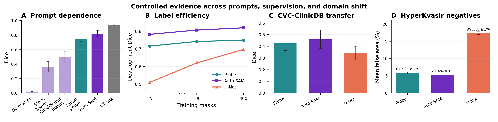

# The Informational Cost of Spatial Prompts in SAM: A Controlled Study on Polyp Segmentation

[Author names and order pending confirmation]

[Affiliations pending confirmation] | Corresponding author: [pending confirmation]

## 1. INTRODUCTION

Removing spatial prompts from Segment Anything (SAM) changes both localization and target specification. For polyp segmentation, a useful diagnosis must distinguish missing mask candidates from failure to select a good candidate. Building on SAM [1], polyp evaluations [2], and automatic prompting [3, 4], we study quality lost when spatial information is removed or degraded, automatic replacements, label efficiency, external transfer, false activation, and computational cost. Human annotation time is not measured; the contribution is controlled empirical evidence rather than a new prompting architecture.

## 2. METHODOLOGY

We use a fixed 400-image training subset and 100 development images from Kvasir-SEG [5]. SAM ViT-B is frozen and uses FP32 at longest-side input 1024. Conditions include empty spatial input, oracle GT points and boxes, prompt perturbations, output selection, static and image-conditioned tokens, a 257-parameter linear probe over frozen image features, and probe-derived box/point prompts. A fixed spatial prior uses median normalized training-mask coordinates. Oracle prompts can reveal component count and are diagnostic ceilings.

A compact U-Net [6] is trained from scratch and continued for 15 fixed epochs at 128 or 256 pixels from identical epoch-30 weights, Adam states, and RNG states. A label-efficiency study uses nested 25/100/400-image subsets and fixed update counts (300 probe; 1,500 U-Net). Seeds 0/1/2 are used. Development intervals bootstrap images after averaging seeds; model and threshold selection uses development data.

Frozen models are applied without adaptation to 612 CVC-ClinicDB frames from 29 sequences [7], with sequence-clustered intervals. False activation is measured on all 1,009 HyperKvasir cecum-class images [8] using predicted area and component size. Those class labels are a negative proxy, not pixel-reviewed negative masks; patient/video IDs are unavailable. CPU latency includes the full RGB-to-mask pipeline.

## 3. RESULTS AND DISCUSSION

Empty input nearly collapses (Dice 0.0089), while oracle points/boxes reach 0.6831/0.9352. Static tokens recover 0.3633, conditioned tokens 0.5013, and the probe 0.7489. Probe-derived box+point prompts raise Dice to 0.8179 (+0.0690 [0.0471, 0.0919]); a fixed train prior reaches only 0.3582, identifying image-specific localization as the main source of recovery.

Candidate availability and selection fail differently: with empty input, the best of four outputs reaches only 0.1824; with a correct point, the best of three reaches 0.8600 versus 0.5401 under predicted-IoU selection. Ranking cannot repair missing candidates, but has headroom after localization.

U-Net 256 reaches 0.8267; SAM−U-Net is −0.0088 [−0.0472, 0.0281], resolving neither superiority nor equivalence. With fixed optimization, SAM exceeds U-Net by +0.2718, +0.1863, and +0.1226 at 25, 100, and 400 masks (all CIs exclude zero), providing a stronger low-label starting point.

On CVC-ClinicDB, Dice falls to 0.4587 for SAM and 0.3405 for U-Net (difference +0.1182 [0.0672, 0.1684]). On HyperKvasir negatives, mean false area is 0.0521 versus 0.1733 (difference −0.1212 [−0.1267, −0.1159]), yet both produce masks in over 99.8% of images. SAM transfers better but neither supports clinical adequacy. Median CPU latency is 8.37 s versus 27.08 ms.

## 4. CONCLUSIONS

Image-specific localization recovers much of SAM's prompt gap, and its decoder improves a coarse probe. U-Net matches Kvasir development quality at far lower cost, whereas SAM is more label-efficient and transfers better externally. Both fail to reject target absence. The contribution is an integrated diagnosis of prompt dependence, candidate generation/selection, utility, and cost—not architectural novelty. Next, an abstention gate should be evaluated on grouped negative videos.

## REFERENCES

[1] A. Kirillov et al., “Segment Anything,” ICCV, 2023.

[2] T. Zhou et al., “Can SAM Segment Polyps?,” arXiv:2304.07583, 2023.

[3] Q. Wu et al., “Self-Prompting,” arXiv:2308.07624, 2023.

[4] T. Shaharabany et al., “AutoSAM,” arXiv:2306.06370, 2023.

[5] D. Jha et al., “Kvasir-SEG: A Segmented Polyp Dataset,” MMM, 2020.

[6] O. Ronneberger et al., “U-Net,” MICCAI, 2015.

[7] J. Bernal et al., “WM-DOVA Maps for Accurate Polyp Highlighting,” CMIG, 2015.

[8] H. Borgli et al., “HyperKvasir,” Scientific Data, 2020.
